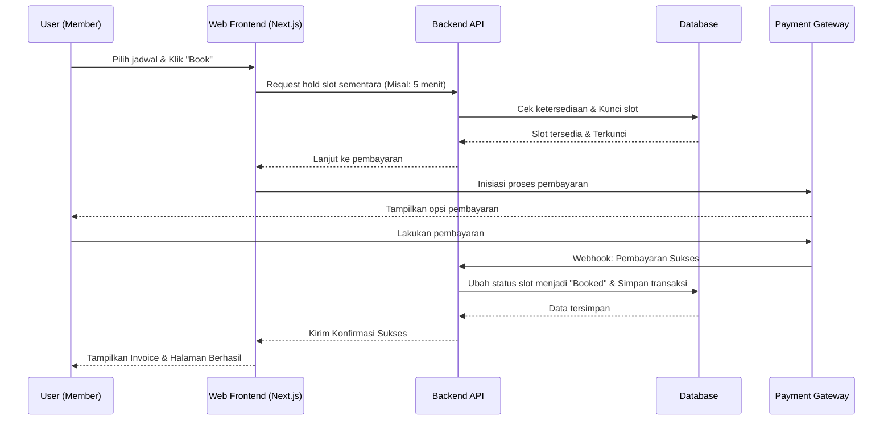
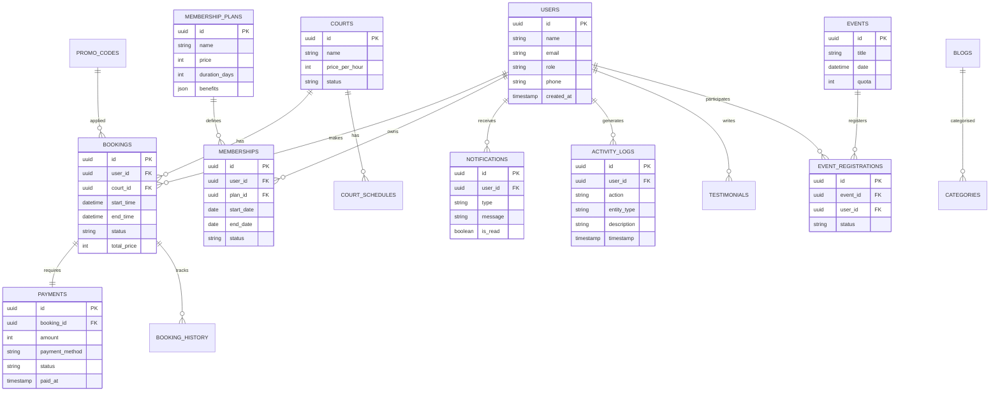

# PRD — Project Requirements Document

## 1. Overview
Padel Society adalah platform digital terintegrasi yang menggabungkan website *company profile* bergaya premium dengan sistem reservasi (booking) lapangan padel secara modern. Saat ini, para pemain padel sering mengalami kendala saat melakukan reservasi secara manual melalui WhatsApp, Instagram, atau telepon. Proses ini memakan waktu, rawan *slow response*, dan memiliki risiko tinggi terjadinya *double booking*. 

Platform ini dibangun untuk menyelesaikan masalah tersebut dengan menyediakan sistem yang memungkinkan pengguna melihat ketersediaan lapangan secara *real-time*, melakukan booking, dan membayar secara otomatis dalam satu ekosistem. Selain memfasilitasi transaksi, Padel Society juga berfungsi sebagai alat pemasaran digital (untuk menampilkan fasilitas, harga, dan *event*) serta menyediakan sistem manajemen operasional lengkap (CMS) bagi admin untuk mengelola bisnis lapangan padel secara efisien.

## 2. Requirements
- **Peran Pengguna (User Roles):**
  - **Guest (Tamu):** Dapat melihat informasi publik, profil perusahaan, fasilitas, ketersediaan jadwal *real-time*, harga, dan melakukan registrasi akun.
  - **Member (Anggota):** Dapat melakukan login, *booking* lapangan, pembayaran digital, melihat riwayat *booking*, mengunduh *invoice*, membatalkan/reschedule (sesuai kebijakan), dan melihat profil.
  - **Admin:** Memiliki akses ke Dashboard CMS untuk mengelola lapangan, jadwal, transaksi, *membership*, *event*, konten website, dan laporan keuangan.
- **Kebutuhan Platform:**
  - Aplikasi harus berbasis web dan sangat responsif (*mobile-first*), mengingat sebagian besar pengguna akan melakukan *booking* melalui ponsel.
  - Memiliki sistem validasi untuk mencegah *double booking* pada jam dan lapangan yang sama.
  - Integrasi dengan *Payment Gateway* lokal (seperti Midtrans/Xendit) untuk verifikasi pembayaran instan tanpa pengecekan manual.
  - Tampilan antarmuka yang premium, modern, dan sejalan dengan identitas *brand* Padel Society.

## 3. Core Features
### 3.1 Modern Company Profile & Landing Page
Halaman utama berdesain premium dengan section sebagai berikut:
- **Hero Section:** Full-screen background video/gambar olahraga padel, headline “Main Padel Tanpa Ribet”, subheadline “Booking lapangan dalam hitungan detik”, dan dua CTA: “Book Now” (ke halaman booking) dan “Jelajahi Fasilitas” (scroll ke section fasilitas). Tujuan: mengurangi bounce rate, langsung mengarahkan ke aksi utama.
- **Statistik Perusahaan:** Angka lapangan, member aktif, event tahunan, dan rating Google. Meningkatkan kepercayaan instan.
- **Tentang Kami (About Us):** Ringkasan cerita Padel Society, visi misi, dan nilai unik. Dilengkapi foto tim/fasilitas.
- **Mengapa Memilih Kami (Why Us):** Kartu-kartu keunggulan: booking real-time, harga transparan, fasilitas premium, komunitas aktif. Setiap kartu dengan ikon dan deskripsi singkat.
- **Daftar Lapangan:** Tampilan grid/kartu lapangan (foto, nama, harga per jam, status “tersedia”). Klik mengarah ke halaman booking dengan filter otomatis lapangan tersebut.
- **Fasilitas:** Galeri foto fasilitas (ruang ganti, parkir, kafe, area tunggu, lighting) dengan deskripsi.
- **Jadwal Hari Ini (Today's Schedule):** Tabel real-time slot yang sudah terisi, membantu pengguna melihat ketersediaan secara cepat.
- **Cara Booking:** 3-4 langkah sederhana (Pilih Jadwal → Bayar → Main) dengan ilustrasi.
- **Testimoni:** Carousel quotes dari member dengan rating bintang.
- **Call to Action (CTA) Akhir:** Ajak bergabung membership atau coba booking pertama.
- **Footer:** Logo, navigasi cepat, kontak, media sosial, newsletter form.

### 3.2 Halaman Sekunder
- **Tentang Kami:** Visi, misi, cerita perusahaan, profil tim, penghargaan.
- **Membership:** Jenis paket, benefit (diskon, prioritas booking, event eksklusif), harga, FAQ, form pendaftaran.
- **Event & Turnamen:** Kategori event (turnamen, gathering, coaching clinic), jadwal, lokasi, kuota, biaya, galeri dokumentasi. Fase selanjutnya: pendaftaran online.
- **Galeri:** Grid foto dan video kegiatan, lapangan, event. Filter kategori.
- **Blog:** Artikel seputar padel (tips, berita, highlight member). Daftar artikel, pencarian, halaman detail dengan share button.
- **FAQ:** Accordion pertanyaan umum (booking, pembayaran, membership, kebijakan).
- **Kontak:** Alamat lengkap, peta Google Maps, formulir inquiry, nomor WhatsApp, jam operasional.

### 3.3 Dashboard Member
- **Dashboard:** Ringkasan booking mendatang, status membership, notifikasi terbaru, saran lapangan.
- **Booking Saya:** Daftar booking aktif & mendatang. Aksi: lihat detail, reschedule, batalkan, unduh invoice.
- **Detail Booking:** Informasi lengkap (lapangan, tanggal, jam, durasi, harga, status, metode bayar). Tombol bayar jika belum lunas.
- **Riwayat Booking:** Semua booking masa lalu, filter status, ekspor CSV.
- **Invoice:** Daftar invoice, unduh PDF, kirim ulang email.
- **Membership:** Status paket, masa berlaku, benefit, riwayat transaksi membership, upgrade/downgrade.
- **Notifikasi:** Inbox semua notifikasi, filter dibaca/belum, hapus.
- **Profil:** Edit nama, foto, nomor telepon, alamat, preferensi.
- **Pengaturan Akun:** Ubah email, nomor HP, preferensi notifikasi (email/WA).
- **Keamanan Akun:** Ubah password, two-factor authentication, sesi aktif.

### 3.4 CMS Admin
- **Dashboard Analytics:** Grafik booking harian/mingguan, pendapatan, lapangan terpopuler, member baru, event terjadwal. Filter periode.
- **Manajemen Booking:** Lihat semua booking, filter status (pending, confirmed, cancelled, completed), cari, edit status manual, lihat detail, batalkan.
- **Manajemen Lapangan:** CRUD lapangan (nama, deskripsi, harga, foto, status aktif/maintenance).
- **Jadwal Lapangan:** Kalender master, set jam operasional, blokir slot manual, lihat keterisian, ekspor.
- **Jadwal Libur Khusus:** Tentukan tanggal libur nasional atau khusus, pengaturan otomatis tutup.
- **Harga Sewa:** Atur harga dasar per jam, harga weekend, harga peak hour, harga member, diskon khusus.
- **Promo:** Kode promo, syarat, diskon, periode berlaku, batas pemakaian.
- **Membership:** Kelola paket, harga, benefit, lihat member aktif, nonaktif, perpanjang manual.
- **Event:** CRUD event, batas peserta, biaya, unggah dokumentasi, lihat pendaftar (jika ada).
- **Blog:** Tulis artikel, kategori, tag, jadwal publikasi, SEO meta.
- **Galeri:** Unggah foto/video, album, hapus, urutkan.
- **FAQ:** Tambah/ubah/hapus pertanyaan.
- **Testimoni:** Kelola testimoni, tampilkan/sembunyikan.
- **Pelanggan:** Lihat daftar member, detail, riwayat booking, riwayat pembayaran, blokir akun.
- **Pengguna:** Manajemen user, tambah admin/operator, hapus.
- **Hak Akses (RBAC):** Role (Super Admin, Admin, Operator), permission matrix.
- **Media Library:** Semua file yang diunggah, folder, pencarian.
- **Pengaturan Website:** Nama, logo, favicon, SEO default, skrip tracking, link sosial media.
- **Aktivitas Sistem:** Log semua tindakan admin, filter, ekspor.
- **Laporan:** Laporan pendapatan, booking, member, event, custom export.
- **Notifikasi:** Kirim notifikasi massal, template pesan, riwayat pengiriman.

## 4. User Flow
### 4.1 Alur Booking End-to-End Mendalam
1. **Pilih Lapangan:** Dari landing page atau halaman booking, pengguna melihat daftar lapangan, klik “Pilih” atau langsung pilih di kalender.
2. **Pilih Tanggal & Jam:** Kalender interaktif menampilkan slot 30 menit (sesuai kebijakan). Slot yang sudah dibooking atau terkunci (sedang dalam proses pembayaran) tampil abu-abu. Slot tersedia berwarna hijau. Pengguna memilih waktu mulai, sistem otomatis menghitung durasi default 1 jam dan menampilkan harga.
3. **Pilih Durasi:** Dropdown 1 jam, 1,5 jam, 2 jam (maks 3 jam). Sistem validasi ketersediaan slot berikutnya secara real-time. Jika terjadi bentrok, tampilkan pesan “Slot tidak tersedia penuh, pilih waktu lain”.
4. **Autentikasi:** Jika belum login, muncul popup/redirect login/register. Setelah login, lanjutkan ke halaman konfirmasi.
5. **Konfirmasi Booking:** Rincian lapangan, tanggal, jam, durasi, total harga, biaya admin, kode promo (jika ada). Validasi kembali slot belum terisi orang lain. Tombol “Lanjutkan Pembayaran”.
6. **Pembayaran:** Sistem membuat booking dengan status `PENDING` dan mengunci slot selama 15 menit. Pengguna diarahkan ke halaman pembayaran (integrasi Midtrans/Xendit). Pilih metode (VA, QRIS, e-wallet). Sistem menampilkan countdown timer 15 menit.
   - **Skenario Sukses:** Payment gateway mengirim webhook sukses → status booking berubah menjadi `CONFIRMED`, slot tetap terkunci, invoice terbit, notifikasi dikirim.
   - **Skenario Expired:** Timer habis → booking otomatis dibatalkan, slot dilepas. Notifikasi pembayaran gagal/gagal bisa dikirim agar pengguna bisa mengulang.
   - **Skenario Gagal:** Pembayaran gagal (dana kurang, bank error) → tetap tampilkan halaman gagal, slot dilepas setelah 15 menit atau pengguna bisa mengulang sebelum timer habis.
7. **Pasca Pembayaran:** Halaman sukses, invoice bisa diunduh, tombol “Lihat Booking Saya”. Notifikasi WhatsApp/Email dikirim.

### 4.2 Skenario Kegagalan Pembayaran & Expired Session
- Jika pengguna menutup browser sebelum bayar, slot akan dilepas otomatis setelah 15 menit.
- Sesi login kadaluwarsa saat pembayaran: sistem akan meminta login ulang, tetapi data booking sementara tetap tersimpan berdasarkan session token. Jika berhasil login kembali dalam 15 menit, proses bisa dilanjutkan.
- Pembayaran kadaluwarsa: status booking `CANCELLED`, slot kembali tersedia secara real-time.

## 5. Architecture
### 5.1 Aturan Bisnis Sistem Booking
- **Jam Operasional:** Default 06:00-22:00 setiap hari, dapat diubah admin per lapangan. Di luar jam itu, slot tidak bisa dipilih.
- **Durasi:** Minimum 1 jam, maksimum 3 jam, kelipatan 30 menit.
- **Buffer Time:** 15 menit antar booking untuk persiapan, tidak tersedia untuk booking.
- **Pencegahan Double Booking:** Database menggunakan mekanisme optimistic locking atau kunci eksklusif pada slot waktu. Saat booking dibuat, slot langsung dikunci di Redis dengan TTL 15 menit. Backend selalu memvalidasi kembali sebelum mengonfirmasi.
- **Status Booking:** 
  - `PENDING`: menunggu pembayaran (slot terkunci sementara).
  - `CONFIRMED`: pembayaran sukses.
  - `CANCELLED`: dibatalkan oleh pengguna atau sistem.
  - `COMPLETED`: setelah waktu selesai lewat (otomatis atau manual).
  - `NO_SHOW`: pengguna tidak hadir (manual oleh admin).
- **Pembatalan:** Member dapat membatalkan maksimal H-6 jam sebelum mulai, dikenakan biaya admin 10% atau dikembalikan sebagai saldo. Admin dapat membatalkan kapan saja tanpa penalti.
- **Reschedule:** Diperbolehkan satu kali hingga H-4 jam sebelum jadwal awal, dengan syarat slot baru tersedia dan selisih harga dibayarkan/dikembalikan.
- **Keterlambatan & No-Show:** Tidak ada pengembalian dana. Lapangan tetap dianggap terpakai.
- **Maintenance:** Admin dapat menandai lapangan `MAINTENANCE` untuk periode tertentu, slot otomatis tidak tersedia.
- **Jadwal Libur:** Tanggal libur khusus diatur, semua lapangan tutup.
- **Masa Berlaku Pembayaran:** 15 menit sejak booking dibuat. Jika gagal bayar, slot dilepas.

### 5.2 Diagram Arsitektur

## 6. Database Schema
Skema konseptual lengkap mencakup entitas inti dan pendukung:

- **Users:** id, name, email, password_hash, role (MEMBER, ADMIN, OPERATOR), phone, avatar, created_at.
- **Roles:** id, name, permissions (JSON).
- **User_Roles:** user_id, role_id.
- **Courts:** id, name, description, price_per_hour (base), status (ACTIVE, MAINTENANCE).
- **Court_Images:** id, court_id, image_url, order.
- **Court_Schedules:** id, court_id, date, start_time, end_time, status (AVAILABLE, BOOKED, MAINTENANCE, BUFFER). Indeks unik (court_id, date, start_time) untuk integritas.
- **Bookings:** id, user_id, court_id, start_time, end_time, status (PENDING, CONFIRMED, CANCELLED, COMPLETED, NO_SHOW), total_price, created_at.
- **Booking_History:** id, booking_id, previous_status, new_status, changed_by, timestamp.
- **Payments:** id, booking_id, amount, payment_method, external_id, status (UNPAID, PAID, FAILED), paid_at, expiry_time.
- **Invoices:** id, booking_id, invoice_number, pdf_url, sent_at.
- **Memberships:** id, user_id, plan_id, start_date, end_date, status (ACTIVE, EXPIRED, CANCELLED).
- **Membership_Plans:** id, name, description, price, duration_days, benefits (JSON), priority_level.
- **Promo_Codes:** id, code, discount_type (PERCENT, FIXED), discount_value, min_booking_amount, max_uses, used_count, valid_from, valid_until, is_active.
- **Events:** id, title, description, location, date, time, quota, registration_fee, image_url, status (UPCOMING, ONGOING, COMPLETED, CANCELLED).
- **Event_Registrations:** id, event_id, user_id, status, payment_status.
- **Blogs:** id, title, slug, content, excerpt, featured_image, category_id, author_id, published_at, status.
- **Categories:** id, name, slug.
- **Gallery:** id, album_id, media_type (IMAGE, VIDEO), url, caption, order.
- **Testimonials:** id, user_id, content, rating, is_visible.
- **Faqs:** id, question, answer, category, order.
- **Notifications:** id, user_id, type, title, message, is_read, created_at.
- **Website_Settings:** key, value.
- **Media_Library:** id, filename, filepath, size, mime_type, uploaded_by, created_at.
- **Activity_Logs:** id, user_id, action, entity_type, entity_id, description, ip_address, timestamp.

## 7. Tech Stack
Berdasarkan kebutuhan platform yang harus mendukung *company profile* responsif, SEO-friendly, sekaligus menangani interaktivitas *booking real-time*, berikut adalah rekomendasi teknologinya:

- **Frontend & Backend (Full-stack Framework):** **Next.js** (App Router). Pendekatan terpusat ini memudahkan pembuatan *Landing Page* yang cepat (Server-Side Rendering untuk SEO) sekaligus menangani sistem *booking* dan API.
- **Styling & UI Components:** **Tailwind CSS** dan **shadcn/ui**. Digunakan untuk membangun UI *Company Profile* bergaya premium dan *Dashboard Admin/Member* yang modern serta dapat dikustomisasi dengan cepat.
- **Database:** **PostgreSQL**. Sangat direkomendasikan dibandingkan SQLite untuk sistem *booking* karena PostgreSQL sangat andal dalam menangani *concurrency* (mencegah bentrok akses saat beberapa pengguna mencoba *booking* jadwal yang sama).
- **ORM:** **Drizzle ORM**. Lebih ringan, *type-safe*, dan sangat cocok dipasangkan dengan Next.js dan PostgreSQL.
- **Authentication:** **Better Auth**. Mengelola login untuk Member dan Admin dengan mudah, aman, dan integrasi yang mulus di ekosistem Next.js.
- **Deployment:** **Vercel** (untuk kemudahan *hosting* Next.js) atau cloud provider lokal jika ada kebutuhan spesifik terkait regulasi penyimpanan data pelanggan lokal. Integrasi tambahan dibutuhkan untuk *Payment Gateway* lokal seperti Midtrans atau Xendit.

## 8. Design System
### 8.1 Identitas Visual
- **Konsep:** Premium, modern, sporty, dan bersih. Menggabungkan nuansa energi padel dengan kesan profesional.
- **Palet Warna:** 
  - **Primary:** `#1E3A8A` (biru tua, melambangkan kepercayaan dan ketenangan).
  - **Secondary:** `#F59E0B` (oranye kuning, aksen energi dan CTA).
  - **Neutral:** `#F8FAFC` (background), `#0F172A` (teks gelap), `#64748B` (teks sekunder).
- **Tipografi:** 
  - Judul: **Poppins** (bold, 700), ukuran H1 48px, H2 36px, H3 24px.
  - Body: **Inter** (regular, 400), ukuran 16px, line-height 1.6.
  - Caption: 14px, label 12px.
- **Grid System:** 12 kolom dengan lebar maksimal 1200px (container), gutter 24px. Mobile-first, breakpoint: sm 640px, md 768px, lg 1024px, xl 1280px.
- **Spacing:** Base unit 4px, kelipatan 4/8/12/16/24/32/48/64px.
- **Border Radius:** Tombol 8px, kartu 12px, modal 16px, input 8px.
- **Shadow:** 
  - `sm`: 0 1px 2px rgba(0,0,0,0.05)
  - `md`: 0 4px 6px rgba(0,0,0,0.1)
  - `lg`: 0 10px 15px rgba(0,0,0,0.15)
  - `xl`: 0 20px 25px rgba(0,0,0,0.2)
- **Icon Style:** Phosphor Icons (outline dan fill), stroke 2px, ukuran 20px untuk UI, 24px untuk tombol.
- **Ilustrasi 3D:** Opsional, gunakan ilustrasi vektor padel di latar belakang hero section, tidak dominan.

### 8.2 Component Style
- **Buttons:** 
  - Primary: background biru tua, teks putih, hover biru lebih gelap.
  - Secondary: border biru, teks biru, hover background biru muda.
  - CTA: oranye, bold, icon panah.
  - Size: sm (h-8), md (h-10), lg (h-12).
- **Cards:** Background putih, shadow-sm, border-radius 12px, padding 16px. Hover: shadow-md.
- **Forms:** Label di atas, input dengan border, fokus border biru, pesan error merah.
- **Tables:** Garis horizontal, header bold, zebra striping ringan.
- **Badges:** Status booking: PENDING kuning, CONFIRMED hijau, CANCELLED merah.
- **Modals:** Overlay gelap, pusat konten, tombol tutup, backdrop blur.
- **Toast Notifications:** Sudut kanan bawah, animasi slide-in, auto-dismiss 5s.
- **Empty State:** Ilustrasi relevan, pesan “Belum ada booking”, ajakan aksi.
- **Loading State:** Skeleton card/table, spinner untuk tombol.

### 8.3 Micro-interactions & Animasi
- Tombol hover scale 1.02, transisi 150ms.
- Halaman transisi: fade-in 200ms.
- Countdown timer pembayaran: animasi smooth.
- Accordion FAQ: smooth expand.
- Scroll reveal: animasi fade-up saat elemen masuk viewport.

### 8.4 Aksesibilitas (WCAG 2.1 AA)
- Kontras teks minimal 4.5:1 untuk body, 3:1 untuk teks besar.
- Semua gambar memiliki alt text.
- Navigasi keyboard penuh, focus ring terlihat.
- Form label eksplisit, error state dengan teks bantuan.
- ARIA attributes untuk komponen dinamis.

## 9. Notification System
### 9.1 Jenis Notifikasi
- **Registrasi Akun:** Email verifikasi (WA opional).
- **Booking Berhasil:** Email + WA: ringkasan booking, tanggal, jam, lapangan, kode booking.
- **Pembayaran Berhasil:** Email + WA: konfirmasi lunas, invoice terlampir.
- **Pembayaran Gagal:** Email: instruksi ulangi, link ke halaman pembayaran.
- **Pembayaran Kedaluwarsa:** Email: booking otomatis dibatalkan.
- **Pengingat Jadwal Bermain:** WA 1 hari sebelum (H-1), dan 2 jam sebelum (H-2h) dengan detail lapangan.
- **Perubahan Jadwal (Reschedule):** Email + WA jika admin mengubah atau member berhasil reschedule.
- **Pembatalan Booking:** Email konfirmasi pembatalan, refund jika berlaku.
- **Event Terbaru:** Email newsletter, WA blast (opt-in) untuk event/turnamen.
- **Membership:** Email: masa berlaku hampir habis, tagihan perpanjangan.
- **Promo:** Email kode promo, WA blast (khusus member).

### 9.2 Alur dan Trigger
- Notifikasi dikirim melalui API pihak ketiga (WhatsApp Business API seperti WATI, Email SMTP/SendGrid).
- Seluruh trigger di-backend: setelah webhook payment, cron job reminder, atau aksi admin.
- Template pesan disimpan di database, variabel diisi dinamis.

## 10. Security & Production Readiness
### 10.1 Autentikasi & Otorisasi
- **Better Auth** untuk login, mendukung email/password, social login (Google) opsional.
- **RBAC:** Role (Super Admin, Admin, Operator) dengan permission berbasis resource (booking, courts, events, etc.). Middleware di API route.
- **Session Management:** JWT httpOnly cookie, expired 7 hari, refresh token.
- **Two-Factor Authentication:** Opsional untuk admin, via authenticator app.

### 10.2 Rate Limiting & Keamanan API
- Rate limiting pada endpoint booking (max 5 request/menit per IP) dan login (10 per menit).
- Validasi input di server menggunakan Zod, proteksi terhadap SQL injection (ORM), XSS (escape output).
- HTTPS enforced, HSTS header.
- CSP (Content Security Policy) untuk mencegah serangan injeksi.

### 10.3 Audit Logs & Monitoring
- **Activity Logs:** Setiap perubahan data oleh admin atau aksi kritis (booking, pembayaran) dicatat dengan user_id, timestamp, IP, action.
- **Monitoring:** Vercel Analytics, Sentry untuk error tracking, log drain ke eksternal (Datadog/CloudWatch).
- **Health Check:** Endpoint `/api/health`.

### 10.4 Backup & Disaster Recovery
- PostgreSQL: daily automated backup, point-in-time recovery (PITR) diaktifkan di managed service.
- Media assets: Cloud Storage (S3) dengan versioning dan cross-region replication.
- Rencana pemulihan dalam 4 jam, RPO 1 jam, RTO 2 jam.

## 11. Roadmap
### 11.1 Phase 1: MVP & Core Booking (3 bulan)
- Landing page premium (semua section).
- Sistem booking real-time dengan pembayaran Midtrans.
- Dashboard Member (booking, riwayat, invoice, profil).
- CMS Admin: manajemen lapangan, jadwal, booking, harga, laporan dasar.
- Autentikasi, notifikasi email/WA esensial.
- Halaman sekunder: Tentang Kami, Fasilitas, Galeri, FAQ, Kontak.

### 11.2 Phase 2: Membership & Events (3 bulan)
- Program membership (paket, benefit, diskon otomatis di booking).
- Dashboard Member: keanggotaan, upgrade.
- CMS Admin: manajemen membership, promo, event CRUD.
- Event & Turnamen halaman publik, integrasi pendaftaran online.
- Blog, halaman testi, sistem notifikasi lengkap.
- Integrasi WhatsApp Business API untuk reminder dan notifikasi.

### 11.3 Phase 3: Advanced Features & Ecosystem (6 bulan)
- AI Smart Booking: rekomendasi jadwal berdasarkan preferensi, prediksi ketersediaan.
- Loyalty Program: poin reward, penukaran hadiah.
- Coaching Management: jadwal pelatih, booking sesi privat.
- Komunitas: forum diskusi, leaderboard, social feed.
- Marketplace: sewa/pembelian perlengkapan padel.
- Mobile Application (React Native) untuk pengalaman native.
- Integrasi dengan wearable/statistik permainan.

Seluruh pengembangan mengikuti praktik CI/CD, testing menyeluruh, dan deployment bertahap menggunakan Vercel dan GitHub Actions.